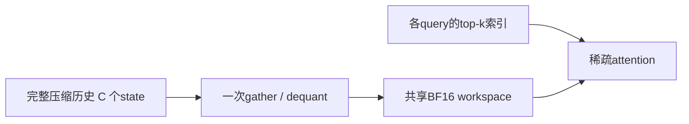

# 从16B复制到共享解码：packed KV 布局的真实取舍

两个格式都能用584B保存一个 V4-Flash state：一种把576B数据行与8B scale行分区，另一种把它们逐行交错。仅比较内容字节数，二者相同；接上真实 reader 后，后者却不能原样维持相同的16B复制对齐。反过来，把访问地址划分成32B区间，二者又可能拥有相同的唯一覆盖量。

这个例子适合建立一个更具体的设计方法：**先找出实际共同搬运的访问组，再分别比较对齐、容量、重复覆盖和跨 query 复用。** 单看 AoS/SoA 标签或“scale在旁边”不足以决定布局。

范围仍固定 vLLM `24c72a76` 的 V4-Flash packed路径。本次补读实际 CuTe prefill gather；此前 `cache_utils.py` 中引用的 Triton reader 是 fallback，`has_cutedsl()` 时会先转到另一个实现。两者不能只凭相同接口就视为已经核对了相同的线程访问。[分派位置](https://github.com/vllm-project/vllm/blob/24c72a76b96bf8d73190a4bb66d47dc8c3eb2134/vllm/models/deepseek_v4/common/ops/cache_utils.py#L520)

## 1. Reader 消费的是三组复制，不是一条584B记录

实际 CuTe gather 用一个 warp 负责一个 stored state，将其搬入该 warp 的 shared stage。源级复制原语明确声明了宽度：

| 访问组 | lanes | 每 lane 字节 | 合计内容 |
|---|---|---:|---:|
| 数据前段 | 0…31 | 16B | 前512B |
| 数据尾段 | 0…3 | 16B | 后64B |
| scale 行 | 4 | 8B | 7个有效scale + padding |

576B数据包含448B FP8和128B BF16，因此第一组也覆盖一部分 BF16 tail。后续从 shared 取出数据、转换成512维BF16输出，并用原始BF16 tail覆盖相应位置。[实际 loader](https://github.com/vllm-project/vllm/blob/24c72a76b96bf8d73190a4bb66d47dc8c3eb2134/vllm/models/deepseek_v4/nvidia/ops/dequant_gather_k_cutedsl.py#L74)

Scale 也已随这一组8B复制进入 shared。随后多个 lane 共享读取某个 scale，是片上复用，不能因为一个 scale 对应64个FP8 channel，就计成64次 global scale读取。决定 global搬运粒度的是前面的 stage copy。[shared scale使用](https://github.com/vllm-project/vllm/blob/24c72a76b96bf8d73190a4bb66d47dc8c3eb2134/vllm/models/deepseek_v4/nvidia/ops/dequant_gather_k_cutedsl.py#L227)

这已经给出一个选择约束：要保留该 reader 的16B数据复制形状，行起点和每段起点需要维持相应自然对齐；不是只要整页总量相同就能互换格式。

## 2. 后置 scale 保留对齐，而逐行 padding 用容量购买对齐

设物理页首地址按32B对齐，比较同样的448FP8、64BF16和8B scale。现有数据行距576B，能让每个 state 的数据起点保持16B/32B对齐；scale区另按8B行距组织。

若改成 `[576B data | 8B scale]` 的584B交错记录，行起点对16B的余数在0/8交替，对32B的余数在0/8/16/24循环。奇数行不能原样保持现有16B copy atom的自然对齐契约。可以改 reader 的复制策略，也可以给每行加 padding：

| N=64 的格式 | 数据行距 | 每页 record extent | 同按576B取整后的页大小 | 失去16B数据自然对齐的行数 |
|---|---:|---:|---:|---:|
| 当前数据/scale分区 | 576B | 37376B | 37440B | 0 |
| 交错584 | 584B | 37376B | 37440B | 32 |
| 交错592 | 592B | 37888B | 38016B | 0 |
| 交错608 | 608B | 38912B | 39168B | 0 |

592是16B的倍数，608是32B的倍数。后两行是反事实格式，不是现有kernel支持项；统一采用576B页大小量化以使对照假设明确。真实新设计也可改变allocator约束，但那将是另一组比较。[当前页大小规则](https://github.com/vllm-project/vllm/blob/24c72a76b96bf8d73190a4bb66d47dc8c3eb2134/vllm/v1/kv_cache_interface.py#L704)

这里可以证明的是一组兼容性与空间结果：**分区放置让576B数据行保持对齐，同时无需把每条记录扩充到592B或608B。** 它不是对作者设计动机的推测，也不是所有workload下的性能排序。实际页基址还有allocation offset、layer/block stride；本模型明确假设32B对齐，不把最小页大小替代全部runtime绑定验证。[编译期页契约](https://github.com/vllm-project/vllm/blob/24c72a76b96bf8d73190a4bb66d47dc8c3eb2134/vllm/models/deepseek_v4/nvidia/ops/dequant_gather_k_cutedsl.py#L371)

## 3. 访问组覆盖之和，与整行唯一覆盖，是不同成本

先只把地址放进32B bins，不解释成实测内存事务。对上面 reader 的512B、64B、8B三个访问组：

| 地址情况 | 每组覆盖的bins | 三组相加 | 整行唯一bins |
|---|---|---:|---:|
| 当前分区，数据起点32B对齐 | 16 / 2 / 1 | 19 | 19 |
| 584交错，行起点余数8/16/24 | 17 / 3 / 1 | 21 | 19 |

交错格式的三组会重叠覆盖某些bin：scale与最后一段数据也可能共享bin。于是21不是21次独立HBM读取。当前格式中，四个相邻state的scale行则可以落在同一个32B bin；不同warp是否真正复用缓存，要看执行与cache行为。

对N=64整页，当前格式和584交错格式的有效内容都唯一覆盖1168个32B bins。**“每组覆盖更整齐”与“总内容更少”可以是两件不同的事实。** 编译器拆合、load/store cache policy、重复命中和并发执行决定这些几何差异怎样转成时间。

另外，584交错的奇数行已经改变了16B复制前提。表里它的21只是同样字节范围的反事实几何，不能把一个尚未适配的reader跑法当成公平benchmark。数值模型同时记录这种不兼容，不输出“预估加速比”。

## 4. 相同格式也不意味着相同 writer 调度

C128 独立 norm/RoPE/store使用8个warp：前7个warp各负责一个64-channel NoPE组，每lane写2B FP8 pair；最后一个warp每lane写4B BF16 pair。每个NoPE warp的lane0写一个scale。对这个生产者，scale行的8B最终内容来自分散的标量写入，不是一条8B集中写。[C128 writer](https://github.com/vllm-project/vllm/blob/24c72a76b96bf8d73190a4bb66d47dc8c3eb2134/vllm/models/deepseek_v4/nvidia/ops/sparse_attn_compress_cutedsl.py#L1481)

C4 fused compress/norm/store不同：每lane处理8个channel，一个量化组只用8个lane，每warp覆盖4组。固定某个pair时，lane间有地址空洞；全部pair写完才填满该组。不能把C128“一warp连续64B”的源级分组套到C4，再据此推一个统一的store事务数。[C4分组](https://github.com/vllm-project/vllm/blob/24c72a76b96bf8d73190a4bb66d47dc8c3eb2134/vllm/models/deepseek_v4/nvidia/ops/sparse_attn_compress_cutedsl.py#L109)、[C4 pair stores](https://github.com/vllm-project/vllm/blob/24c72a76b96bf8d73190a4bb66d47dc8c3eb2134/vllm/models/deepseek_v4/nvidia/ops/sparse_attn_compress_cutedsl.py#L362)

这让优化对象更明确：一个布局同时服务压缩输出、反量化gather和attention消费者。优化reader的自然复制单位，未必同时优化所有writer；producer/consumer的权重还会随prefill/decode比例变化。

## 5. 真正需要比较的，还有“解码多少次”

这个固定版本的prefill路径并不是“top-k选512个，就只反量化512个”。它先给 compressed gather 传入 `seq_lens // compress_ratio` 和 `gather_lens=None`，将每个请求的完整压缩历史写成BF16 workspace；再组合top-k与SWA索引，最后执行 sparse attention。[实际prefill链](https://github.com/vllm-project/vllm/blob/24c72a76b96bf8d73190a4bb66d47dc8c3eb2134/vllm/models/deepseek_v4/nvidia/flashmla.py#L329)

因此布局优化面对的是一个共享物化阶段；最终attention的稀疏度不自动成为这个阶段的稀疏度。这个结论只覆盖已核对的prefill路径，不外推外部FlashMLA decode。

比较两个明确的方案：

- **实际路径：** 对一个请求的C个压缩state物化一次，供本次prefill的多个query复用。
- **反事实逐query选择性gather：** 每个query独立物化K个选择项，不做跨query去重，仍输出同样的BF16表示。

令Qp为该请求本次prefill的query数，且每个query有足够历史使用K个选择。忽略SWA、索引、参数和launch，前者转换次数为C，后者为QpK。每次转换的逻辑payload为584B packed读取加1024B BF16输出。二者在Qp=C/K处交叉；这只是同单位转换工作量的比较，尚未包含metadata、并行度与缓存。

例如C4处理N=1048576个输入后的C=262144，K=512。完整gather的内容量为146MiB packed输入、256MiB BF16输出；这是一次该请求history物化的逻辑字节数，不是每个query独占的HBM流量，也不是workspace峰值总和。

| Qp | 反事实独立选择的state访问次数 | 相对完整gather的转换次数 |
|---:|---:|---:|
| 128 | 65536 | 0.25× |
| 512 | 262144 | 1× |
| 2048 | 1048576 | 4× |

短query组可能避免大量无用反量化；长query组却可能因重复选择同一历史而多做转换。进一步的选择是先求选择集并集U、只物化U次，再重映射query索引；或者把反量化融合到attention的读取中。这些方案各自支付去重/planning/间接寻址或重复转换成本，不能只以K远小于C宣布胜出。

实际prefill plan还会把若干请求分组，workspace按组内最大尺寸和SWA空间留容量。容量 `chunk_size×chunk_M` 与实际处理的 \(\sum_i C_i\) 也不是同一个数。不能从预留shape直接认定所有padding都被反量化。

## 6. 两个小反例，防止把局部结论变成规则

**删掉padding scale不一定缩页。** N64时7B scale而非8B可少64B内容，但在相同576B页量化下，两者最小页都为37440B，只是页尾间隙增加。7B行距还会破坏现有8B scale copy的自然对齐，不能不改reader就当作免费删掉一个byte。这仍可能改变访存或通信内容，却没有在这个例子中释放一个更小的物理页。

**逐行交错也可以满足同一复制单位。** 新补读的同一个CuTe reader还支持一个独立的V4.1格式分支：512个全FP8维度、16B scale，逐行528B。528是16的倍数，因此交错放scale也能保留16B数据复制的自然对齐。这里仅借该固定格式分支作反例，不把V4.1结构拼进V4-Flash，也不声明完整V4.1运行支持。[格式分支](https://github.com/vllm-project/vllm/blob/24c72a76b96bf8d73190a4bb66d47dc8c3eb2134/vllm/models/deepseek_v4/nvidia/ops/dequant_gather_k_cutedsl.py#L27)

可以迁移的选择方法是：固定表示精度和内容，找出每个阶段真正共同搬运的字节，保留复制与分配契约，再比较跨query的复用范围。布局整齐度、有效字节、物化次数与最终吞吐需要分别计费。

## 模型与证据范围

`layout-cost-model.mjs`用逐字节身份数组构造四种布局，验证对齐、32B几何覆盖、相同payload和页量化；同时保存共享/独立gather的逻辑工作量例子。模型没有GPU cache、实际指令拆分、内存事务或时间预测。固定源、连续锚点与来源边界见`layout-tradeoff-research/notes.md`和收据；其中也区分了CuTe生产路径与Triton fallback。

没有执行GPU、编译器SASS检查、layout benchmark或整模型性能实验；没有核对外部decode内核、SWA fused writer和全部allocator模式。本文给出可被后续实验区分的设计对照，不替未测方案宣布性能排名。
